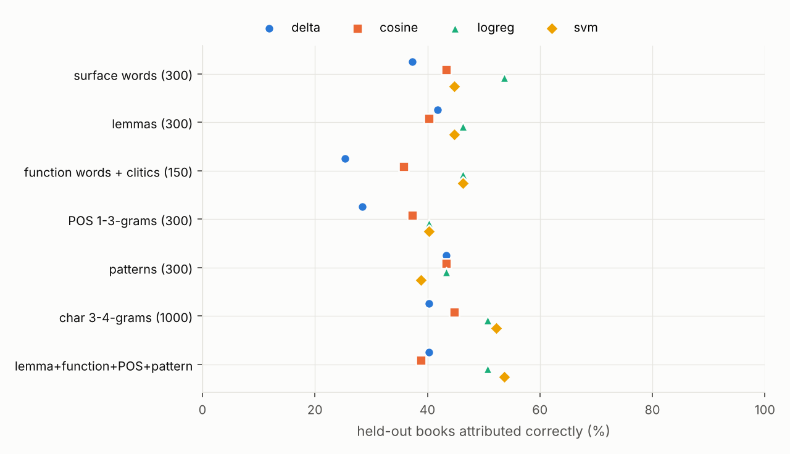
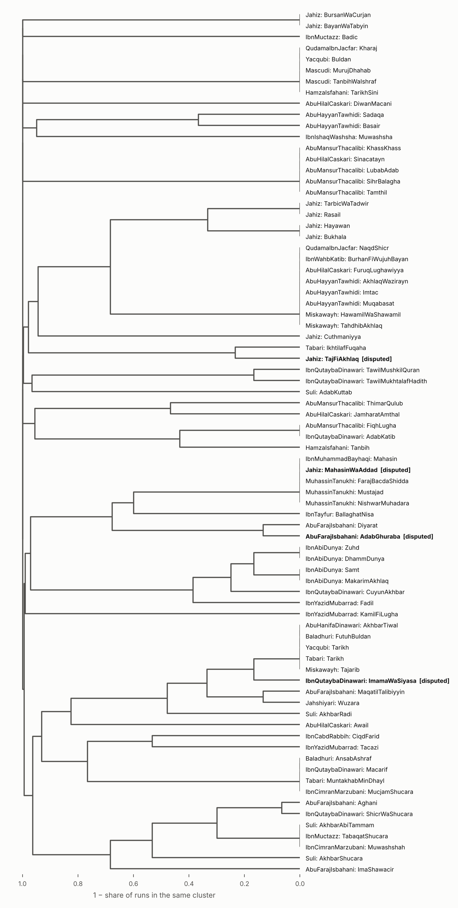
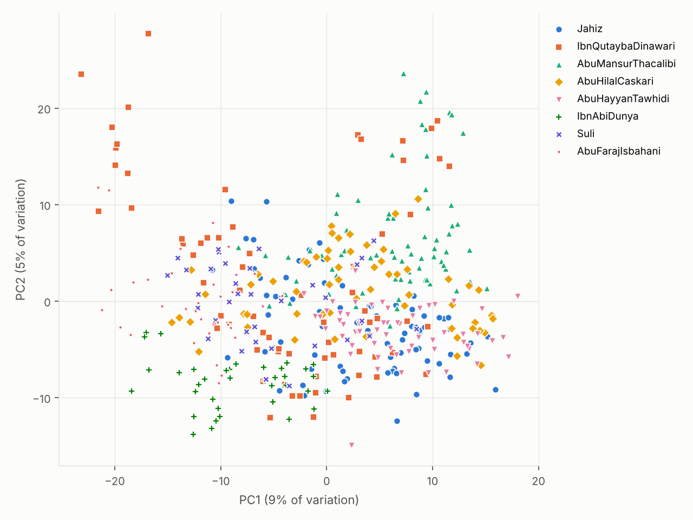
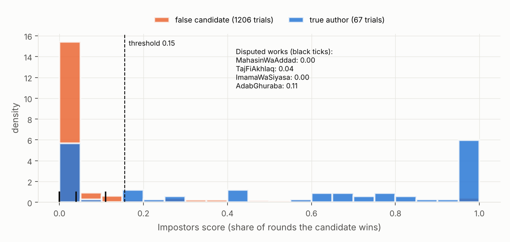

# Layer 3: stylometry, first results (November 2026)

**In short:** on the benchmark corpus, attribution works well *within a genre*
and fails *across genres*. Among 19 candidate authors (chance = 5%), the best
methods attribute about half of all held-out books correctly: 62–65% of books
whose genre the author also wrote in elsewhere, but almost none of the 12 books
that are the author's only work in their genre. Distinctive stylists are
recognized every time: al-Jāḥiẓ 7/7 books, al-Tawḥīdī 5/5, Ibn Abī l-Dunyā 4/4.
Compilers whose own voice is thin (al-Balādhurī, al-Mubarrad, al-Marzubānī) are
not. Verification is calibrated (AUC 0.83). None of the four disputed works is
stylistically consistent with its traditional author. For *al-Maḥāsin
wa-l-aḍdād* the nearest author is al-Bayhaqī, whose *al-Maḥāsin wa-l-masāwī*
also shares 10.9% of its text with it.

All numbers come from the files in this folder; regenerate them with the
commands at the end.

## Setup

- **Samples:** 922 chunks of ~2,000 of the authors' own words (after editorial
  cleanup and quotation/isnād removal), 12 per book spread evenly through each
  book, plus every chunk of the four disputed works. Each was run through
  layer 1 (spelling restoration + CAMeL's MSA morphology, the stand-in for
  layer 2).
- **Candidates:** the 19 authors with at least two secure books. **Test:**
  leave one *book* out (67 books). Features and z-score statistics come from
  the training books only, and a book's attribution is the majority vote of its
  samples.
- **Feature sets:** restored word forms; lemmas; function words and clitics
  (و، ف، ب، ل، ال, pronoun suffixes); POS 1–3-grams; morphological patterns
  (أوزان, case vowel removed); character 3–4-grams; and the combination
  lemma + function + POS + pattern.

## 1. Attribution accuracy



Books attributed correctly (samples in brackets), 67 held-out books, 19 candidates:

| Feature set | Burrows's Delta | Cosine Delta | Logistic regression | Linear SVM |
|---|---|---|---|---|
| surface words (300) | 37% (34%) | 43% (39%) | 54% (43%) | 45% (39%) |
| lemmas (300) | 42% (35%) | 40% (36%) | 46% (38%) | 45% (37%) |
| function words + clitics (150) | 25% (20%) | 36% (30%) | 46% (35%) | 46% (33%) |
| POS 1-3-grams (300) | 28% (28%) | 37% (29%) | 40% (35%) | 40% (33%) |
| patterns (300) | 43% (31%) | 43% (31%) | 43% (34%) | 39% (32%) |
| char 3-4-grams (1000) | 40% (37%) | 45% (37%) | 51% (43%) | 52% (43%) |
| lemma+function+POS+pattern | 40% (34%) | 39% (35%) | 51% (44%) | 54% (40%) |

The classifiers beat the Delta measures, and Cosine Delta beats Burrows's Delta
in most rows. The morphological combination equals the best surface baseline
(54%) but doesn't beat it yet: with modern-Arabic morphology, lemmas and POS
add little over word forms. Measuring whether Classical morphology changes
this is the job of layer 2.

## 2. The genre wall

| Feature set, method | Same-genre books (55) | Cross-genre books (12) |
|---|---|---|
| surface words (300), logreg | 36 (65%) | 0 (0%) |
| char 3-4-grams (1000), svm | 34 (62%) | 1 (8%) |
| lemma+function+POS+pattern, svm | 34 (62%) | 2 (17%) |
| function words + clitics (150), svm | 28 (51%) | 3 (25%) |
| POS 1-3-grams (300), logreg | 27 (49%) | 0 (0%) |

"Same-genre" means the author has another secure book in the same genre;
"cross-genre" books are the author's only work in their genre (e.g. Ṭabarī's
*Ikhtilāf al-fuqahāʾ*, the only law book among his three). Most misattributions
go to another author of the *same* genre. Function words and clitics are the
most genre-robust set, as stylometric theory predicts, but even they reach
only 3 of 12.

**Negative result:** subtracting each genre's mean profile ("genre
centering") lowered accuracy (combined SVM 54% → 42%) and did not help the
cross-genre books. In this corpus genre and author are tangled (several authors
wrote only history), so removing the genre norm removes author signal too. The
option stays in `stylometry/evaluate.py` (`genre_center`), off by default.

## 3. Per author (lemma+function+POS+pattern, SVM)

| Author | Books right | Misattributed |
|---|---|---|
| Jahiz | 7/7 | — |
| AbuHayyanTawhidi | 5/5 | — |
| IbnAbiDunya | 4/4 | — |
| Mascudi | 2/2 | — |
| AbuMansurThacalibi | 5/6 | *ThimarQulub* → AbuHilalCaskari |
| MuhassinTanukhi | 2/3 | *NishwarMuhadara* → HamzaIsfahani |
| Miskawayh | 2/3 | *Tajarib* → IbnYazidMubarrad |
| AbuHilalCaskari | 3/5 | *FuruqLughawiyya* → IbnQutaybaDinawari; *JamharatAmthal* → IbnQutaybaDinawari |
| AbuFarajIsbahani | 2/4 | *Diyarat* → MuhassinTanukhi; *MaqatilTalibiyyin* → IbnYazidMubarrad |
| IbnQutaybaDinawari | 2/6 | *CuyunAkhbar* → Jahiz; *Macarif* → Baladhuri; *ShicrWaShucara* → IbnCimranMarzubani; *TawilMukhtalafHadith* → Jahiz |
| Tabari | 1/3 | *IkhtilafFuqaha* → AbuHayyanTawhidi; *Tarikh* → IbnQutaybaDinawari |
| Suli | 1/4 | *AdabKuttab* → IbnQutaybaDinawari; *AkhbarAbiTammam* → IbnCimranMarzubani; *AkhbarShucara* → IbnMuctazz |
| IbnYazidMubarrad | 0/3 | *Fadil* → AbuHayyanTawhidi; *KamilFiLugha* → Jahiz; *Tacazi* → AbuHayyanTawhidi |
| Baladhuri | 0/2 | *AnsabAshraf* → AbuFarajIsbahani; *FutuhBuldan* → QudamaIbnJacfar |
| Yacqubi | 0/2 | *Buldan* → Mascudi; *Tarikh* → Jahiz |
| IbnMuctazz | 0/2 | *Badic* → Suli; *TabaqatShucara* → IbnQutaybaDinawari |
| QudamaIbnJacfar | 0/2 | *Kharaj* → Baladhuri; *NaqdShicr* → Miskawayh |
| HamzaIsfahani | 0/2 | *Tanbih* → IbnQutaybaDinawari; *TarikhSini* → Mascudi |
| IbnCimranMarzubani | 0/2 | *MucjamShucara* → IbnQutaybaDinawari; *Muwashshah* → IbnQutaybaDinawari |

Writers with a strong personal manner of argument or exhortation are
recognized; authors of compilations, biographical dictionaries and administrative
works are not. Their own prose is a thin frame around material they transmit,
and two of these authors also have one book per genre (Qudāma: *Kharāj* /
*Naqd al-shiʿr*; Ibn al-Muʿtazz: *Badīʿ* / *Ṭabaqāt*). Ibn Qutayba acts as a
magnet for misattributions (8 books), probably because his six books span
almost every genre.

## 4. Structure of the corpus



Bootstrap consensus tree of all 78 book profiles (three feature-set sizes ×
ten random 80% feature subsets, average linkage on co-membership). What groups
together:
- **al-Jāḥiẓ's core works** (*Ḥayawān*, *Bukhalāʾ*, *Rasāʾil*, *Tarbīʿ*) form
  their own cluster.
- **Ibn Abī l-Dunyā's four zuhd works**, with Ibn Qutayba's *ʿUyūn*.
- **The historians** (Ṭabarī, Yaʿqūbī, Balādhurī, Miskawayh, Dīnawarī).
- **Poets' biographies** (*Aghānī*, *al-Shiʿr wa-l-shuʿarāʾ*, Ibn al-Muʿtazz's
  *Ṭabaqāt*, *Muwashshaḥ*).
- **Anecdote collections** (al-Tanūkhī's three books, al-Bayhaqī,
  *al-Maḥāsin wa-l-aḍdād*).

The tree mostly sorts by genre, with authorship visible inside genres.



PCA of the samples of the eight best-represented authors (combined features).
**PC1** (9% of variation) runs from narrative prose full of proper names
(noun_prop, verb + noun_prop) to discursive prose with common nouns, the
article and relative clauses. **PC2** (5%) separates subordinating syntax
(أنْ / أنّ, negation, على) from words the modern dictionary doesn't know (UNK).
That second axis partly measures Classical vocabulary missing from CAMeL's MSA
lexicon, which layer 2 and the Qabas extension address. Loadings:
`pca_loadings.json`.

## 5. Verification: Impostors calibration



For each of the 67 secure books: one **true trial** (the real author, profiled
from his other books) and 18 **false trials** (another candidate, with the
real author removed from the line-up of impostors: the realistic case for a
disputed work). The score is the share of 200 rounds, each with half the
features and 10 random impostors, in which the candidate is closer than every
impostor.

| | |
|---|---|
| AUC (all trials) | 0.83 (same-genre trials: 0.86) |
| Threshold (best balanced accuracy) | 0.15 → balanced accuracy 77.6% |
| True authors passing, same-genre books | 46 / 55 (84%) |
| True authors passing, cross-genre books | 1 / 12 |
| False candidates passing | 181 / 1,206 (15%) |

A line-up restricted to same-genre impostors calibrated *worse* (AUC 0.76,
`verification_samegenre.json`), so the default line-up uses all authors.
**Reading a score:** within a genre the candidate has written in, a score
below 0.15 is evidence against him (only 9 of 55 true authors fall that low);
a score above it is weaker evidence for him, because 15% of false candidates
pass, mostly genre-mates.

## 6. The disputed works

| Disputed work | Candidate | Samples | Impostors score | Candidate's rank (of 26) | Nearest author | Score / rank after removing shared text |
|---|---|---|---|---|---|---|
| *MahasinWaAddad* | Jahiz | 24 | 0.00 | 19 | IbnMuhammadBayhaqi | 0.00 / 21 (38,633 of 50,913 words kept) |
| *TajFiAkhlaq* | Jahiz | 12 | 0.04 | 7 | IbnWahbKatib | 0.04 / 7 (21,544 of 24,314 words kept) |
| *ImamaWaSiyasa* | IbnQutaybaDinawari | 58 | 0.00 | 16 | IbnMuhammadBayhaqi | 0.00 / 16 (110,220 of 118,092 words kept) |
| *AdabGhuraba* | AbuFarajIsbahani | 5 | 0.11 | 4 | MuhassinTanukhi | 0.02 / 9 (8,028 of 9,284 words kept) |

**Shared text** (share of the disputed work's 8-word sequences found in another book):
- *MahasinWaAddad*: *Mahasin* (IbnMuhammadBayhaqi) 10.9%, *Hayawan* (Jahiz) 0.5%, *Aghani* (AbuFarajIsbahani) 0.5%
- *TajFiAkhlaq*: *Mahasin* (IbnMuhammadBayhaqi) 4.1%, *MurujDhahab* (Mascudi) 1.0%, *BayanWaTabyin* (Jahiz) 0.8%
- *ImamaWaSiyasa*: *CiqdFarid* (IbnCabdRabbih) 1.3%, *AnsabAshraf* (Baladhuri) 0.6%, *Tarikh* (Tabari) 0.5%
- *AdabGhuraba*: *Diyarat* (AbuFarajIsbahani) 12.0%, *FarajBacdaShidda* (MuhassinTanukhi) 0.5%, *Mahasin* (IbnMuhammadBayhaqi) 0.2%

Compilations copy from common sources, and copied passages make two books
look alike for reasons other than the compiler's style. So each disputed work
was verified a second time with every 8-word sequence it shares with *any*
benchmark book removed (last column).

- ***al-Maḥāsin wa-l-aḍdād* (pseudo-Jāḥiẓ?)** Not consistent with al-Jāḥiẓ:
  score 0.00, and he ranks 19th of 26 (21st once shared text is removed). Its
  nearest author is al-Bayhaqī, *before and after* removing the 24% of its text
  shared with other books, so the resemblance is stylistic, not only copied
  passages. Zeta shows why it isn't al-Jāḥiẓ. He consistently uses the
  vocabulary of argument (زعم، دليل، معنى، جاز، أشبه، ربما، جملة، جهة); the
  disputed book uses narrative vocabulary (انصرف، أخبر، أيها، نادى، سار، ليلة)
  and more vocative and *fa-* constructions. Its overlap with al-Jāḥiẓ is
  concentrated in *al-Ḥayawān* and *al-Bayān*, consistent with the Shamela
  edition's note that its opening chapters were lifted from those two books.
  This agrees with the scholars (Pellat; Shawqī Ḍayf) who consider it
  spurious, and points to the circle of al-Bayhaqī's *al-Maḥāsin wa-l-masāwī*.
- ***al-Tāj fī akhlāq al-mulūk*.** Not consistent with al-Jāḥiẓ (0.04; rank 7).
  Nearest is *al-Burhān fī wujūh al-bayān* by Ibn Wahb al-Kātib, a secretary's
  treatise on eloquence. Part of the gap is
  topic: Sasanian court material (أنوشروان، أردشير، مملكة، رعية) against al-Jāḥiẓ's
  زعم/معنى. A secretarial *adab* author is a better fit than al-Jāḥiẓ.
- ***al-Imāma wa-l-siyāsa*.** Not consistent with Ibn Qutayba (0.00; rank 16
  of 26). It sits among the historians and akhbār compilers (al-Bayhaqī,
  al-Jahshiyārī, Abū Ḥanīfa al-Dīnawarī, Ibn ʿAbd Rabbih). It is also the
  largest sample (58 chunks), so the verdict is the most robust of the four,
  with one caution: Ibn Qutayba's own history book, *al-Maʿārif*, is a
  reference handbook, not narrative history, so this is close to a cross-genre
  comparison.
- ***Adab al-ghurabāʾ*.** Weakest evidence: only 5 chunks (~9,000 words). Below
  the threshold (0.11, rank 4), and lower once shared text is removed (0.02,
  rank 9). It shares 12% of its text with Abū l-Faraj's own *al-Diyārāt*,
  which could mean an author reusing his material or a later compiler drawing
  on him. Its style is closest to al-Tanūkhī's tales of hardship. Treat this as
  inconclusive.

## Limitations

- **Genre dominates.** Cross-genre attribution is not solved; verdicts are
  meaningful only where the candidate wrote in the same genre.
- **Modern-Arabic morphology.** Lemmas and POS come from CAMeL's MSA model
  (e.g. وعبر "crossed" analysed as عبّر "expressed"), and many Classical words are
  unknown to it (the UNK axis in the PCA). Layer 2 should improve this, and this
  benchmark will measure by how much.
- **Sample:** 12 chunks per book. Processing the full 4,378 chunks
  (~7 hours here) would tighten the estimates.
- **Remaining non-authorial text:** reported speech, unmarked verse in 17
  editions, and quotations from sources outside the reference sets.

## Reproduce

```bash
python -m corpus.build DATA_DIR                    # corpus + editorial cleanup
python -m corpus.quotations DATA_DIR REFS_DIR      # quotations, isnads, authorial chunks
python -m stylometry.analyze_chunks DATA_DIR --per-book 12   # layer 1 (~1.5 h on 2 CPUs)
python -m stylometry.evaluate DATA_DIR --out reports/layer3
python -m stylometry.verify DATA_DIR --out reports/layer3
python -m stylometry.report DATA_DIR --out reports/layer3
```
